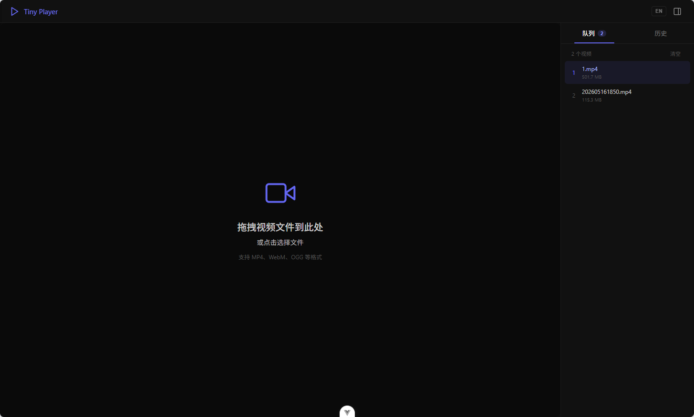

# Tiny Player

> [English Version](./README.md)

一个简洁的本地视频播放器，基于 **Vue 3 + Vite** 构建。所有播放都在浏览器本地完成，视频文件不会上传到任何服务器。



## 功能特性

- **本地播放**：将视频文件拖拽到播放区域，或点击区域选择文件，直接在浏览器中播放。
- **播放队列**：拖入多个视频可自动连播，支持「上一个 / 下一个」切换。
- **播放历史**：自动记录播放过的视频，刷新页面后可在「历史」中查看并恢复。
- **进度记忆**：自动保存并恢复播放进度、音量与倍速（基于 `localStorage` 持久化）。
- **播放控制**：进度条拖拽跳转、音量调节、倍速（0.5x–2x）、全屏。
- **键盘快捷键**：不使用鼠标也能轻松操控。
- **深色界面**：支持侧边栏显隐，专注播放体验。

## 技术栈

- Vue 3（`Composition API` + `<script setup>`）
- Pinia + `pinia-plugin-persistedstate`（状态管理与持久化）
- Vite 8
- vue-router（已集成，路由暂未配置）

## 快速开始

环境要求：**Node.js** `^20.19.0 || >=22.12.0`，包管理器使用 **pnpm**。

```sh
pnpm install        # 安装依赖
pnpm dev            # 启动开发服务器（热更新）
pnpm build          # 构建生产版本，输出到 dist/
pnpm preview        # 本地预览生产构建
```

> 若使用 npm / yarn，可对应替换为 `npm install` / `yarn` 等命令。

## 使用说明

1. 打开应用后，将视频文件拖拽到中央播放区域，或点击该区域选择文件。
2. 将视频拖拽到右侧侧边栏，可将其加入播放队列；侧栏提供「队列」与「历史」两个标签页。
3. 播放进度、音量、倍速以及播放历史会自动保存到浏览器本地，刷新或重新打开页面后依然保留。
   > 注意：持久化仅保存播放记录与进度信息，视频文件本身不会被保存，历史中的文件需重新拖入才能再次播放。

## 键盘快捷键

| 按键 | 功能 |
| --- | --- |
| `空格` / `k` | 播放 / 暂停 |
| `←` / `→` | 快退 / 快进 5 秒 |
| `↑` / `↓` | 音量 + / - |
| `f` | 切换全屏 |
| `m` | 静音 / 取消静音 |

## 项目结构

```
tiny-player/
├── index.html             # 应用入口 HTML
├── vite.config.js         # Vite 配置（含 @ 别名指向 src）
├── public/               # 静态资源（favicon 等）
└── src/
    ├── main.js           # 应用入口，挂载 Pinia 与持久化插件
    ├── App.vue           # 根组件，布局与拖拽/连播逻辑
    ├── components/
    │   ├── VideoPlayer.vue   # 视频播放器与自定义控制栏
    │   └── PlayHistory.vue   # 播放队列与历史侧边栏
    ├── stores/
    │   └── player.js         # Pinia 播放状态（含持久化）
    └── router/
        └── index.js         # vue-router 实例
```

## 自定义配置

构建输出路径在 `vite.config.js` 中通过 `base` 配置，生产环境默认部署到 `/tiny-player/` 子路径。

更多 Vite 配置参见 [Vite Configuration Reference](https://vite.dev/config/)。

## 推荐开发环境

- [VS Code](https://code.visualstudio.com/) + [Vue (Official)](https://marketplace.visualstudio.com/items?itemName=Vue.volar) 插件（请禁用 Vetur）。
- 浏览器安装 [Vue.js devtools](https://chromewebstore.google.com/detail/vuejs-devtools/nhdogjmejiglipccpnnnanhbledajbpd) 以获得更好的调试体验。
